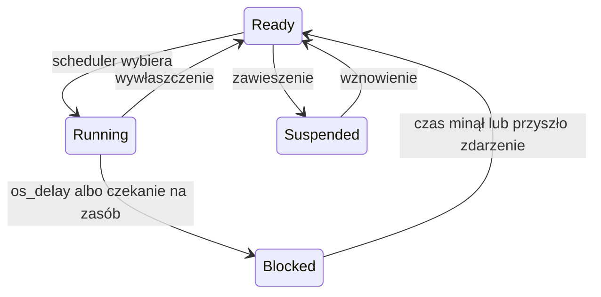

# 01 — Od pętli `while(1)` do RTOS-a

> Źródło: dokument „Własny RTOS — STM32F746G-DISCO” z rozmowy z 2026-11-24.
> Wersja w repozytorium jest kanoniczna; zmiany wprowadzaj tutaj.

## Po co ten dokument

RTOS pozwala pisać każdą czynność jako osobną pętlę `while(1)`, która czeka bez marnowania procesora i nie spowalnia reszty programu. Ten dokument dochodzi do tej idei krok po kroku, zaczynając od klasycznej pętli głównej mikrokontrolera.

Każdy krok to kod, a potem jego ograniczenie. To ograniczenie uzasadnia następny krok. Na końcu będziesz wiedzieć, czym jest zadanie, co robi scheduler i co dokładnie dzieje się w procesorze Cortex-M7 przy przełączaniu kontekstu.

Docelowa płytka to STM32F746G-DISCO. Szczegóły implementacji są w kolejnych dokumentach projektu.

## Punkt wyjścia: pętla główna (superloop)

Typowy program na mikrokontroler to inicjalizacja i nieskończona pętla, która po kolei obsługuje wszystko. Przy dwóch czynnościach działa świetnie, przy pięciu zaczyna się sypać.

```c
int main(void) {
    hw_init();

    while (1) {
        led_toggle();
        delay_ms(500);              // procesor kręci się w miejscu przez 500 ms

        if (button_pressed())
            uart_send("klik\r\n");

        if (uart_has_byte())
            handle_command(uart_read());
    }
}
```

Co jest z tym kodem nie tak:

1. **Blokujące opóźnienie.** Przez 500 ms `delay_ms` program nie widzi przycisku ani UART-u. Krótkie naciśnięcie zginie, a drugi bajt z UART-u nadpisze pierwszy w rejestrze odbiorczym (błąd overrun).
2. **Czas reakcji to suma wszystkiego.** Każda gałąź pętli wydłuża obieg. Dodasz rysowanie ekranu trwające 20 ms i nagle wszystko inne reaguje o 20 ms wolniej.
3. **Wszystko jest ze sobą splecione.** Zmiana jednej czynności wymaga sprawdzenia, czy nie zepsuła czasów pozostałych.
4. **Procesor nigdy nie śpi.** Czekanie to aktywne kręcenie się w pętli, więc pobór prądu jest maksymalny nawet wtedy, gdy nic się nie dzieje.

## Ewolucja bez RTOS-a

Zanim sięgnie się po RTOS, superloop zwykle przechodzi trzy etapy. Każdy rozwiązuje część problemów, ale żaden nie daje naraz szybkiej reakcji i prostego kodu.

### Krok 1: przerwania i flagi

Przerwanie od razu odbiera bajt, więc dane nie giną. Pętla główna tylko sprawdza flagę.

```c
volatile bool    rx_flag;
volatile uint8_t rx_byte;

void USART1_IRQHandler(void) {
    rx_byte = USART1->RDR;          // odczyt czyści flagę RXNE
    rx_flag = true;
}

// w while(1):
if (rx_flag) { rx_flag = false; handle_command(rx_byte); }
```

Ograniczenie: obsługa danych nadal czeka na swój obieg pętli. Dochodzą też wyścigi między przerwaniem a pętlą i pilnowanie `volatile`.

### Krok 2: nieblokujące czekanie i maszyny stanów

SysTick co 1 ms zwiększa licznik `ticks`. Każda czynność sprawdza, czy minął jej czas, i od razu wraca, zamiast czekać.

```c
volatile uint32_t ticks;            // ticks++ w SysTick_Handler co 1 ms

void led_job(void) {
    static uint32_t last;
    if (ticks - last >= 500) {      // odejmowanie działa też po przepełnieniu licznika
        last += 500;
        led_toggle();
    }
}
```

Problem pojawia się przy procesach wieloetapowych, np. „wyślij komendę, poczekaj na odpowiedź, ponów po timeoucie”. Trzeba je ręcznie pociąć na stany:

```c
switch (state) {
case SEND: uart_send("AT\r"); t0 = ticks; state = WAIT; break;
case WAIT: if (got_ok())               state = DONE;
           else if (ticks - t0 > 1000) state = SEND;
           break;
case DONE: break;
}
```

To, co naturalnie zapisałbyś w trzech liniach, rozpada się na stany i zmienne `static`. Każdy kolejny etap dokłada nowy stan.

### Krok 3: scheduler kooperacyjny

Czynności trafiają do tablicy z okresami, a pętla główna woła te, na które przyszedł czas.

```c
typedef struct { void (*fn)(void); uint32_t period, last; } job_t;

job_t jobs[] = { {led_job, 500}, {button_job, 10}, {uart_job, 1} };

while (1)
    for (int i = 0; i < N_JOBS; i++)
        if (ticks - jobs[i].last >= jobs[i].period) {
            jobs[i].last += jobs[i].period;
            jobs[i].fn();
        }
```

To już prawie system operacyjny, ale **kooperacyjny**: każda funkcja musi sama szybko oddać sterowanie. Jedna, która liczy 50 ms, zatrzymuje wszystkie pozostałe. Kod nadal jest pocięty na maszyny stanów.

> W repozytorium dokładnie ten etap jest zaimplementowany w `app/main.c` (etap 1 projektu).

**Wniosek:** chcemy pisać `send(); wait_for_reply(); parse();` jak zwykły kod i żeby czekanie nie blokowało innych. Do tego każda czynność potrzebuje własnego stosu i własnej kopii rejestrów. Tym właśnie jest zadanie w RTOS-ie.

## Idea RTOS-a: zadania i scheduler

Zadanie to funkcja z własną nieskończoną pętlą, własnym stosem i własną kopią rejestrów procesora. Scheduler przełącza procesor między zadaniami tak szybko, że wygląda to, jakby działały równolegle.

```c
void led_task(void *arg) {
    while (1) {
        led_toggle();
        os_delay(500);              // zadanie śpi, procesor robi w tym czasie coś innego
    }
}

void uart_task(void *arg) {
    while (1) {
        uint8_t b = queue_receive(&rx_queue, OS_WAIT_FOREVER);  // śpi do przyjścia bajtu
        handle_command(b);
    }
}

int main(void) {
    hw_init();
    os_task_create(led_task,  NULL, PRIO_LOW);
    os_task_create(uart_task, NULL, PRIO_HIGH);
    os_start();                     // od tej chwili rządzi scheduler, main nigdy nie wraca
}
```

Kod wygląda jak superloop z początku, ale każda czynność ma własną pętlę. `os_delay` nie kręci się w miejscu: oznacza zadanie jako uśpione do konkretnego ticka i oddaje procesor innym.

### Co jest w zadaniu

Jądro opisuje każde zadanie strukturą TCB (Task Control Block). To jedyne, co scheduler musi wiedzieć o zadaniu.

```c
typedef struct tcb {
    uint32_t   *sp;             // zapisany wskaźnik stosu, MUSI być pierwszym polem
    uint8_t     prio;           // priorytet
    task_state_t state;         // RUNNING, READY, BLOCKED, SUSPENDED
    uint32_t    wake_tick;      // kiedy obudzić po os_delay
    struct tcb *next;           // miejsce na liście gotowych lub śpiących
} tcb_t;
```

Pole `sp` jest pierwsze celowo: kod w asemblerze zapisuje je i odczytuje jedną instrukcją, bez liczenia przesunięć.

### Stany zadania

Zadanie jest zawsze w jednym z czterech stanów, a tylko jedno naraz jest w stanie Running.



| Stan | Znaczenie |
|---|---|
| Ready | gotowe, czeka na CPU |
| Running | wykonuje się teraz |
| Blocked | czeka na czas lub zasób |
| Suspended | wyłączone z planowania |

Zadanie przechodzi do Blocked, gdy czeka, i wraca do Ready, gdy minie czas albo przyjdzie zdarzenie. Z Ready do Running przenosi je wyłącznie scheduler.

### Wywłaszczanie i priorytety

Zasada jest jedna: **zawsze działa gotowe zadanie o najwyższym priorytecie**. Gdy przyjdzie bajt z UART-u, przerwanie wkłada go do kolejki i `uart_task` staje się gotowe. Ma wyższy priorytet niż bieżące zadanie, więc scheduler od razu je wywłaszcza, nawet w środku obliczeń.

Dzięki temu czas reakcji zadania nie zależy od zadań o niższym priorytecie. Dodanie wolnego rysowania ekranu z niskim priorytetem nie opóźni obsługi UART-u. Gdy nic nie jest gotowe, działa zadanie idle z instrukcją `WFI`, która usypia procesor do najbliższego przerwania.

### Porównanie podejść

| | Superloop | Scheduler kooperacyjny | RTOS z wywłaszczaniem |
|---|---|---|---|
| Czas reakcji | suma całej pętli | najdłuższa funkcja | przełączenie kontekstu, jeśli zadanie ma najwyższy priorytet |
| Styl kodu | prosty, dopóki mały | maszyny stanów | zwykły, sekwencyjny kod z czekaniem |
| RAM | jeden stos | jeden stos | osobny stos na każde zadanie |
| Nowe klasy błędów | mało | mało | wyścigi, zakleszczenia, przepełnienie stosu, inwersja priorytetów |

RTOS nie jest za darmo. Każde zadanie zajmuje RAM na stos, przełączenie kontekstu kosztuje kilkadziesiąt cykli zegara, a współdzielone dane trzeba chronić.

## Jak to działa na Cortex-M7

Przełączenie kontekstu to zapisanie rejestrów jednego zadania na jego stosie i wczytanie rejestrów drugiego z jego stosu. Cortex-M ma do tego sprzętowe wsparcie, więc cały mechanizm to kilkanaście instrukcji asemblera.

### Cztery elementy układanki

- **SysTick** – timer rdzenia, przerwanie co 1 ms (tick). Odlicza czas, budzi zadania po `os_delay` i zgłasza potrzebę przełączenia.
- **PendSV** – przerwanie, które można wywołać programowo bitem w `SCB->ICSR`. To w nim faktycznie przełączamy kontekst. Dostaje najniższy priorytet, więc uruchamia się dopiero po zakończeniu wszystkich innych przerwań i nigdy nie przerywa ich w połowie.
- **SVC** – instrukcja `svc`, czyli wywołanie systemowe. Użyjemy jej do uruchomienia pierwszego zadania.
- **Dwa wskaźniki stosu** – MSP dla jądra i przerwań, PSP dla zadań. Przerwanie zawsze działa na MSP, więc stos zadania zostaje nietknięty i łatwo go zapisać.

### Co odkłada sprzęt, a co my

Przy wejściu w przerwanie procesor **sam** odkłada na stos zadania 8 rejestrów: R0–R3, R12, LR, PC i xPSR. Jeśli zadanie używało FPU, dochodzą S0–S15 i FPSCR. Cała reszta, czyli R4–R11 i ewentualnie S16–S31, należy do nas.

Połowa pracy jest więc zrobiona automatycznie. Handler PendSV dokłada brakujące rejestry, podmienia stosy i wraca z przerwania, a sprzęt zdejmuje resztę ze stosu już innego zadania.

### Przebieg jednego przełączenia

1. Zadanie A działa na swoim stosie (PSP).
2. Przychodzi SysTick. Sprzęt odkłada 8 rejestrów A na stos A i przechodzi na MSP.
3. SysTick budzi zadanie B o wyższym priorytecie i ustawia bit PENDSVSET.
4. Po wyjściu z SysTick od razu startuje PendSV (bez powrotu do A, mechanizm tail-chaining).
5. PendSV zapisuje R4–R11 na stos A, a PSP zapisuje w TCB zadania A.
6. Scheduler wybiera B. PendSV wczytuje PSP z TCB zadania B i zdejmuje jego R4–R11.
7. Powrót z przerwania: sprzęt zdejmuje 8 rejestrów ze stosu B, w tym PC, i procesor kontynuuje zadanie B dokładnie tam, gdzie je kiedyś przerwano.

### Szkic handlera PendSV

```asm
PendSV_Handler:
    mrs     r0, psp                 @ stos bieżącego zadania
    tst     lr, #0x10               @ bit 4 EXC_RETURN == 0 -> zadanie używało FPU
    it      eq
    vstmdbeq r0!, {s16-s31}         @ zapisz górne rejestry FPU
    stmdb   r0!, {r4-r11, lr}       @ zapisz R4-R11 i EXC_RETURN
    ldr     r1, =current_tcb
    ldr     r2, [r1]
    str     r0, [r2]                @ current_tcb->sp = PSP

    cpsid   i
    bl      os_pick_next            @ C: ustawia current_tcb na następne zadanie
    cpsie   i

    ldr     r1, =current_tcb
    ldr     r2, [r1]
    ldr     r0, [r2]                @ PSP nowego zadania
    ldmia   r0!, {r4-r11, lr}
    tst     lr, #0x10
    it      eq
    vldmiaeq r0!, {s16-s31}
    msr     psp, r0
    bx      lr                      @ sprzęt zdejmuje R0-R3, R12, LR, PC, xPSR
```

To szkic do zrozumienia idei. Docelowa wersja będzie maskować przerwania przez `BASEPRI` zamiast `cpsid` i doda bariery `dsb`/`isb`.

### Jak wystartować zadanie, które nigdy nie działało

Trik polega na przygotowaniu stosu nowego zadania tak, **jakby już kiedyś zostało przerwane**. Pierwszy „powrót” z przerwania skacze wtedy na początek funkcji zadania.

```c
uint32_t *sp = stack_top;               // wyrównany do 8 bajtów
*--sp = 0x01000000;                     // xPSR: ustawiony bit Thumb
*--sp = (uint32_t)fn & ~1u;             // PC: tu zadanie wystartuje
*--sp = (uint32_t)task_exit;            // LR: gdyby funkcja zadania kiedyś wróciła
*--sp = 0;                              // R12
*--sp = 0; *--sp = 0; *--sp = 0;        // R3, R2, R1
*--sp = (uint32_t)arg;                  // R0: argument zadania
*--sp = 0xFFFFFFFD;                     // EXC_RETURN: tryb wątku, PSP, ramka bez FPU
for (int i = 0; i < 8; i++)
    *--sp = 0;                          // R11..R4
tcb->sp = sp;
```

Kolejność odpowiada dokładnie temu, co odkłada sprzęt i nasz `stmdb` w PendSV. Pomyłka o jedno słowo kończy się wyjątkiem HardFault, więc to pierwsza rzecz do sprawdzenia w debuggerze.

> W repozytorium `port/cortex-m7/fault.c` zapisuje przy HardFaulcie ramkę wyjątku i rejestry błędu do zmiennej `port_fault` — patrz docs/02.

## Synchronizacja i komunikacja

Skoro zadanie może zostać wywłaszczone w dowolnej instrukcji, współdzielone dane trzeba chronić. RTOS daje do tego cztery narzędzia, a każde służy do czego innego.

### Problem: wyścig

```c
volatile uint32_t counter;

void task_a(void *arg) { while (1) counter++; }
void task_b(void *arg) { while (1) counter++; }
```

`counter++` to trzy instrukcje: odczyt, dodanie i zapis. Jeśli przełączenie wypadnie między odczytem a zapisem, jedno zwiększenie zginie. Taki błąd pojawia się rzadko i losowo, więc bardzo trudno go złapać.

### Narzędzia

| Mechanizm | Do czego | Przykład w projekcie |
|---|---|---|
| Sekcja krytyczna | kilka instrukcji, których nic nie może przerwać | modyfikacja list schedulera, `counter++` |
| Semafor | sygnał „coś się stało”, zwykle z przerwania do zadania | DMA skończyło transfer, zadanie się budzi |
| Mutex | wyłączny dostęp do zasobu na dłużej | dwa zadania piszą `printf` na ten sam UART |
| Kolejka | przekazanie danych między zadaniami lub z przerwania | bajty z UART-u, zdarzenia z ekranu dotykowego |

Sekcja krytyczna to po prostu chwilowe zamaskowanie przerwań. Musi trwać kilka instrukcji, bo w tym czasie system nie reaguje na nic. Semafor zastępuje flagę z kroku 1: zadanie nie sprawdza jej w kółko, tylko śpi, dopóki przerwanie go nie obudzi.

### Inwersja priorytetów

To klasyczna pułapka przy mutexach. Zadanie L o niskim priorytecie bierze mutex. Budzi się zadanie H o wysokim priorytecie, chce ten sam mutex i musi czekać. Wtedy zadanie M o średnim priorytecie wywłaszcza L, więc H czeka na M, choć M w ogóle nie korzysta z mutexu.

Rozwiązaniem jest **dziedziczenie priorytetu**: na czas trzymania mutexu L dostaje priorytet H, więc M nie może go wywłaszczyć. Ten błąd słynnie restartował sondę Mars Pathfinder w 1997 roku. Dlatego mutex w naszym RTOS-ie od początku będzie miał dziedziczenie priorytetu.

### Zasada dla przerwań

Przerwanie nigdy nie może czekać. Z handlera wolno tylko „dać” semafor albo włożyć element do kolejki, bez blokowania. Branie mutexu czy czekanie na kolejkę w przerwaniu to błąd projektowy.

## Plan projektu

Kod dzielimy na warstwy, żeby jądro nie wiedziało nic o płytce. Dzięki temu przejście później na STM32H7S78-DK oznacza wymianę tylko warstwy płytki.

```
┌──────────────────────────────────────────────────────────────────────┐
│ app/ — aplikacja                                                     │
│ Twoje zadania: LED, UART, ekran, sieć. Korzysta wyłącznie z API jądra│
├──────────────────────────────────────────────────────────────────────┤
│ kernel/ — jądro                                                      │
│ Scheduler, TCB, semafory, mutexy, kolejki, timery. Czyste C,         │
│ zero rejestrów sprzętowych.                                          │
├──────────────────────────────────────────────────────────────────────┤
│ port/ — Cortex-M7                                                    │
│ PendSV, SVC, SysTick, FPU, sekcje krytyczne. Wspólne dla F746 i H7S78│
├──────────────────────────────────────────────────────────────────────┤
│ bsp/ — płytka   ◄── jedyna warstwa wymieniana przy zmianie płytki    │
│ Zegary, piny, UART, SDRAM, LCD, linker script.                       │
└──────────────────────────────────────────────────────────────────────┘
        STM32F746G-DISCO (teraz)          STM32H7S78-DK (później)
```

Każda warstwa korzysta tylko z tej pod sobą. Jądro i port pozostają bez zmian przy przejściu na inną płytkę z Cortex-M7.

### Etapy

- [ ] **Bare-metal start:** startup, linker script, zegar 216 MHz, SysTick, dioda LD1, `printf` przez UART z ST-Linka. *(kod gotowy w szablonie, czeka na test na płytce)*
- [ ] **Przełączanie kontekstu:** TCB, stosy, PendSV, start pierwszego zadania przez SVC, round-robin dla 2–3 zadań.
- [ ] **Scheduler priorytetowy:** bitmapa gotowych zadań z instrukcją `CLZ`, `os_delay`, lista śpiących, zadanie idle z `WFI`.
- [ ] **Synchronizacja:** sekcje krytyczne przez `BASEPRI`, semafory, mutexy z dziedziczeniem priorytetu, kolejki.
- [ ] **Sterowniki pod RTOS-em:** UART z DMA, SDRAM, ekran (LTDC + DMA2D), dotyk.
- [ ] **Sieć:** stos lwIP na naszym jądrze.
- [ ] **Dodatki:** MPU, wykrywanie przepełnienia stosu, tickless idle, statystyki obciążenia CPU.

### Narzędzia

Linux, CLion (licencja niekomercyjna), kompilator `arm-none-eabi-gcc`, OpenOCD do debugowania przez ST-Link. Projekt budowany przez CMake. Szczegóły w [02 — Środowisko i pierwszy start](02-srodowisko-i-pierwszy-start.md).

### Kolejne dokumenty

1. **02 — Środowisko i pierwszy start:** instalacja narzędzi, struktura repozytorium, startup, linker script, miganie diodą.
2. **03 — Przełączanie kontekstu:** pierwsze dwa zadania na round-robin.
3. **04 — Scheduler z priorytetami i czasem.**
4. **05 — Synchronizacja.**
